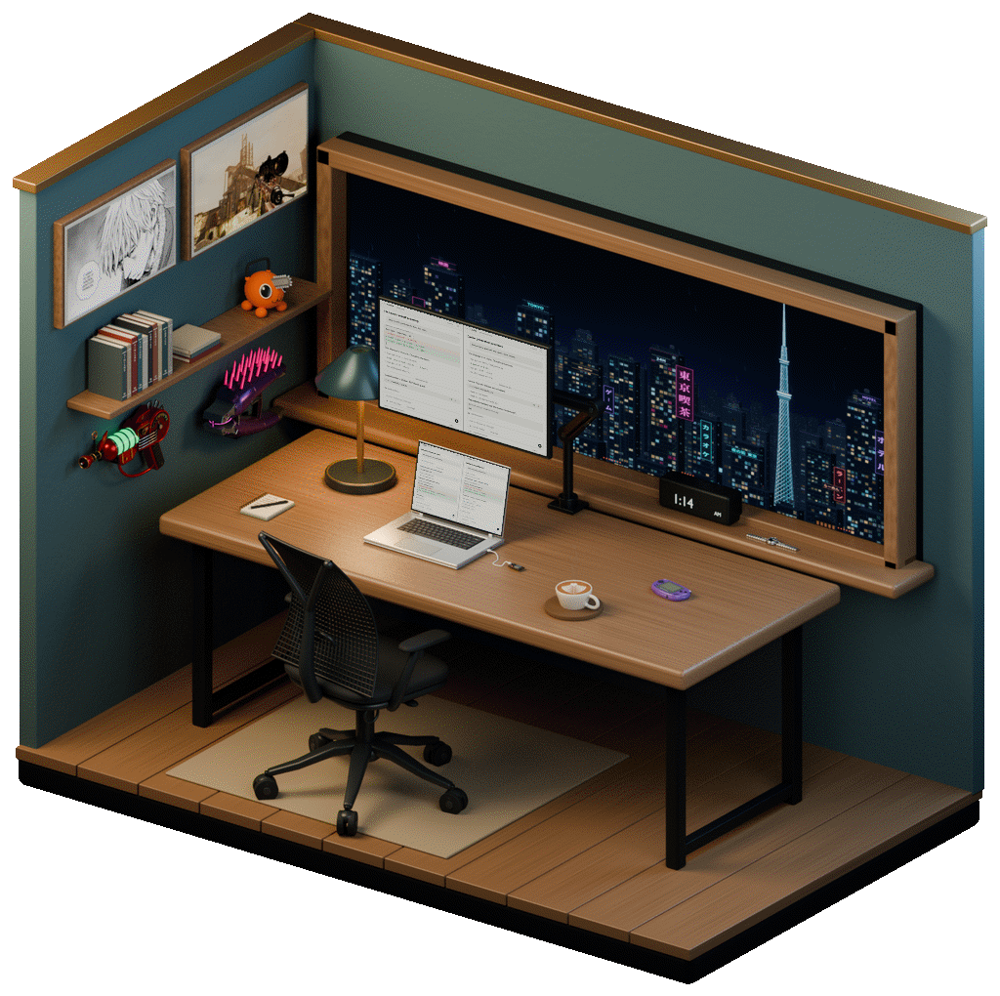

<table>
  <tr>
    <td width="36%" valign="top">
      
    </td>
    <td valign="top">
      <ul>
        <li>Grew up with a controller in my hands and a computer within reach.</li>
        <li>At 11, led WoW raids against the Lich King and benched grown men with mortgages. My first management role.</li>
        <li>At 13, played professional Call of Duty before esports was a thing.</li>
        <li>At 18, taught myself to code sneaker bots and restock monitors. First internet money. Proud sneaker Twitter alum.</li>
        <li>At 19, dropped out for a full-time software engineering job at a F500.</li>
        <li>At 23, took my work abroad. Solo traveled through 20+ countries, made a home in a Oaxacan beach town, learned Spanish.</li>
        <li>At 26, quit to build something of my own. Plenty of failures, plenty learned.</li>
        <li>At 28, potentially descending into AI psychosis but having a lot of fun.</li>
      </ul>
    </td>
  </tr>
</table>

<!--
**barnesc13/barnesc13** is a ✨ _special_ ✨ repository because its `README.md` (this file) appears on your GitHub profile.

Here are some ideas to get you started:

- 🔭 I’m currently working on ...
- 🌱 I’m currently learning ...
- 👯 I’m looking to collaborate on ...
- 🤔 I’m looking for help with ...
- 💬 Ask me about ...
- 📫 How to reach me: ...
- 😄 Pronouns: ...
- ⚡ Fun fact: ...
-->
